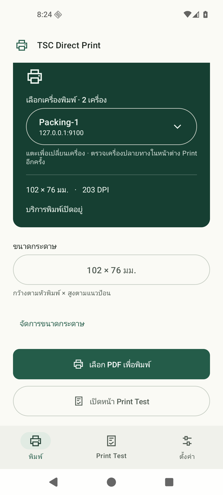
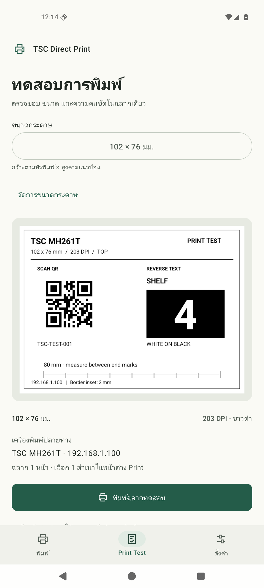
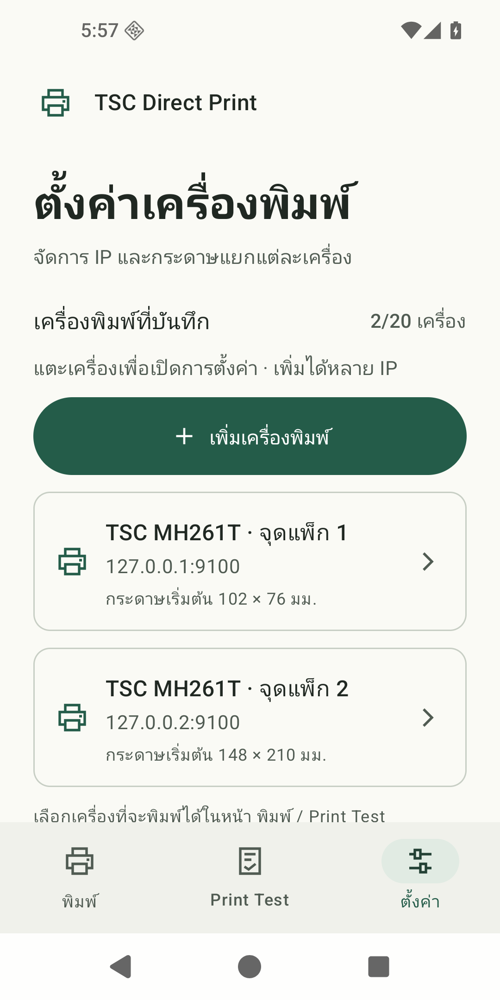
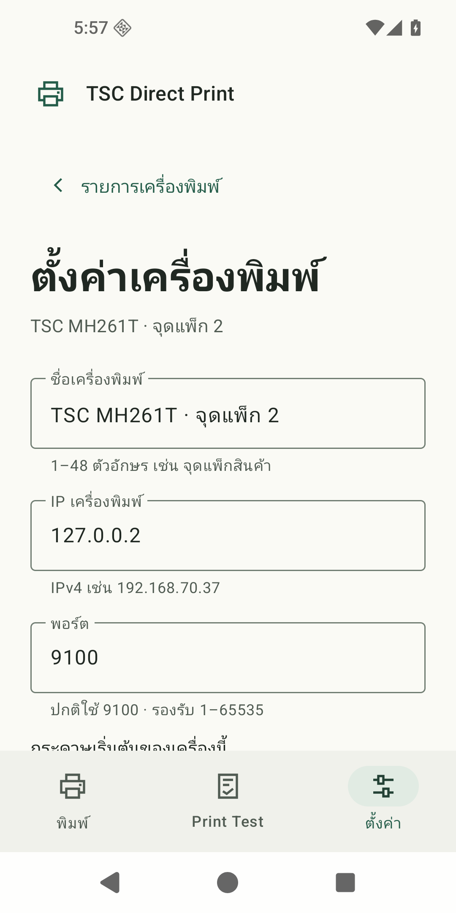
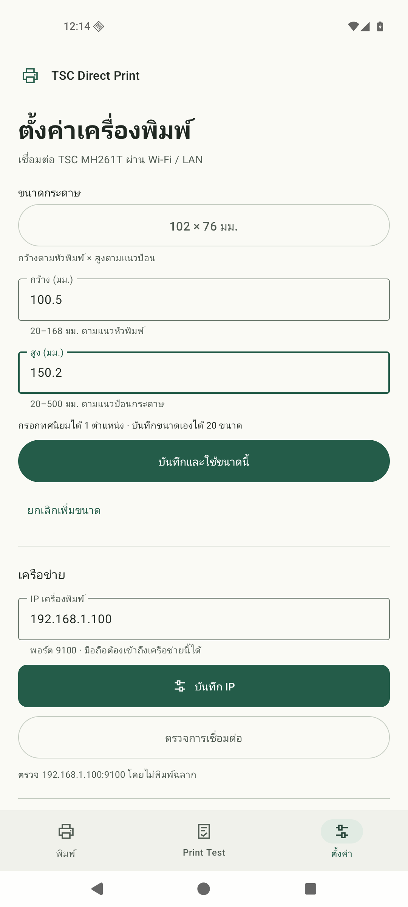
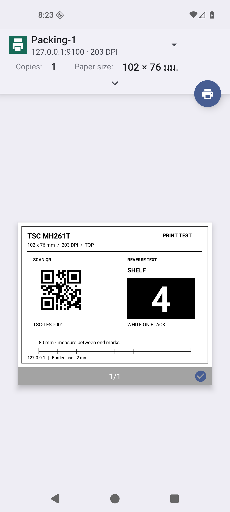
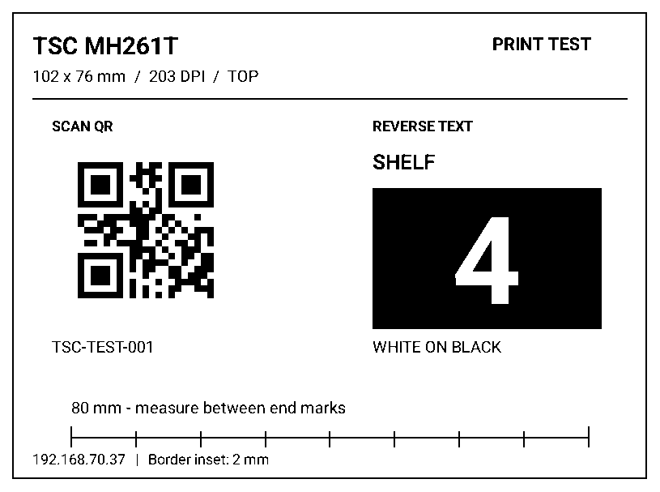

# TSC Direct Print

**พิมพ์ฉลากจาก Android ตรงถึง TSC MH261T ผ่าน Wi-Fi / LAN ด้วยเมนู Print ทั่วไป**

An Android Print Service that sends PDF labels directly to a TSC MH261T over TCP 9100, with multiple named printers, print tests and custom paper sizes. [English guide](docs/README.en.md).

**เวอร์ชันซอร์สปัจจุบัน: 1.3.3** — แตะรายการเพื่อตั้งค่ารายเครื่อง และเลือกเครื่องที่จะพิมพ์ในหน้า Print / Print Test ดูรายละเอียดที่ [Changelog](CHANGELOG.md#133--2026-10-15)

[](app/src/main/AndroidManifest.xml)
[](LICENSE)
[](https://github.com/FlintsLabs/tsc-android-print/actions/workflows/android.yml)

**[ดาวน์โหลด APK](https://github.com/FlintsLabs/tsc-android-print/releases/latest)** · [ติดตั้ง](#ติดตั้งและเริ่มใช้งาน) · [แก้ปัญหา](docs/troubleshooting.md) · [Build](docs/building.md) · [Changelog](CHANGELOG.md)

<p align="center">
  
  
  
  
</p>

ภาพหน้า Print / Print Test จาก 1.2.0 และหน้ารายการ / ตั้งค่ารายเครื่องจาก 1.3.3 บน Android emulator; IP ในภาพเป็นตัวอย่าง ต้องตั้งให้ตรงกับเครื่องพิมพ์ของคุณ ภาพ system Print ใช้ loopback receiver สำหรับ preview

## ใหม่ใน 1.3.3

- **ตั้งค่า → แตะชื่อเครื่องพิมพ์** เพื่อแก้ชื่อ, IP, พอร์ต และกระดาษเริ่มต้น พร้อมตรวจการเชื่อมต่อ พิมพ์ทดสอบ และลบเครื่อง
- เปิด แก้ไข หรือเพิ่มเครื่องอื่นได้โดยคงเครื่องที่เลือกพิมพ์ไว้ เลือกปลายทางในแอปจากหน้า **พิมพ์ / Print Test**
- ขนาดกระดาษในฟอร์มมีผลเมื่อกด **บันทึกเครื่องพิมพ์**; หากยังมีค่าที่ไม่บันทึก ปุ่มตรวจ/ทดสอบจะไม่ทำงาน
- อัปเดตทับรุ่นเดิมด้วย APK ที่ลงลายเซ็นเดียวกันเพื่อเก็บข้อมูลเดิม ดู [ผลทดสอบและข้อจำกัด](docs/verification.md)

## ความสามารถ

- ใช้ **Print** จาก browser, โปรแกรมอ่าน PDF และแอปที่รองรับ Android printing
- บันทึกเครื่องพิมพ์ได้ 20 เครื่อง แยกชื่อ / IPv4 / พอร์ต / กระดาษเริ่มต้น และเลือกได้ทั้งหน้า Print และ Print Test
- เลือก PDF จากในแอป แล้วเปิดหน้าพิมพ์ของ Android
- แปลง PDF → ภาพขาวดำ 203 DPI → TSPL `BITMAP` → เครื่องพิมพ์โดยตรง
- Preset **102 × 76 มม.** และ **148 × 210 มม. (A5)** พร้อมเพิ่มขนาดเอง
- **Print Test** มีกรอบ 4 ด้าน เส้นวัด QR และข้อความสีขาวบนพื้นดำ
- เลือกหน้า จำนวนสำเนา และแนวกระดาษจากหน้าพิมพ์ของระบบ
- UI ภาษาไทย ธีมสว่าง/มืด และ navigation rail สำหรับจอกว้าง

ไม่ต้องใช้ Mac, USB หรือ print server เป็นตัวกลาง ไม่มี telemetry และไม่ส่งเอกสารไป cloud

## สิ่งที่ต้องมี

| รายการ | รองรับ |
| --- | --- |
| มือถือ / tablet | Android 13 ขึ้นไป (API 33+) |
| เครื่องพิมพ์ที่ทดสอบจริง | TSC MH261T, 203 DPI |
| เครือข่าย | มือถือเข้าถึง IPv4 ของเครื่องพิมพ์ผ่าน TCP ของเครื่องพิมพ์ได้ (ปกติ 9100) |
| กระดาษ | กว้าง 20–168 มม. × สูง 20–500 มม. ภายในข้อจำกัดของแอป |
| เอกสารต้นทาง | PDF หรือแอปที่มีเมนู Android Print |

รุ่น TSPL อื่นและหัวพิมพ์ 300/600 DPI ยังไม่ได้ทดสอบ เวอร์ชันนี้กำหนด 203 DPI สำหรับทุกโปรไฟล์ ไม่ได้แปลงโปรโตคอลให้เครื่องพิมพ์ที่ไม่รองรับ TSPL

## ติดตั้งและเริ่มใช้งาน

1. ดาวน์โหลด `TSC-Direct-Print-<version>.apk` จาก **[Releases](https://github.com/FlintsLabs/tsc-android-print/releases/latest)**
2. เปิด APK บน Android 13+ และอนุญาตติดตั้งจากแอปที่เปิดไฟล์เมื่อ Android ขอ
3. เปิด **TSC Direct Print → ตั้งค่า → แตะชื่อเครื่องพิมพ์** กรอกชื่อ / IPv4 / พอร์ต / กระดาษเริ่มต้น แล้วกด **บันทึกเครื่องพิมพ์** ค่าเดิม `192.168.70.37:9100` จะถูกเก็บไว้เมื่ออัปเดต
4. แตะชื่อเครื่องอีกครั้งแล้วกด **ตรวจการเชื่อมต่อ** เพื่อตรวจ IP/พอร์ตของเครื่องในหน้ารายละเอียด โดยยังไม่ส่งฉลาก
5. กลับ **รายการเครื่องพิมพ์ → จัดการบริการพิมพ์** แล้วเปิด **TSC Direct Print** ในหน้าการพิมพ์ของ Android
6. เลือกเครื่องและขนาดในหน้า **พิมพ์ / Print Test** ให้ตรงกับฉลาก แล้วเปิดเอกสารและกด **Print → ชื่อเครื่องพิมพ์ที่บันทึก**
7. ตรวจ preview, Paper size, แนวกระดาษ, หน้า และจำนวนสำเนา ก่อนยืนยันพิมพ์

อนุญาตสิทธิ์เครือข่ายภายในเมื่อ Android รุ่นที่ใช้งานขอ ชื่อเมนูระบบอาจต่างกันตามยี่ห้อ

ตรวจหมายเลขเวอร์ชันของ APK ใน Releases ก่อนดาวน์โหลด หากยังไม่มี 1.3.3 ให้ [build จากซอร์ส](docs/building.md) การ push ซอร์สขึ้น GitHub ไม่ได้อัปโหลด APK เป็น Release อัตโนมัติ

ไม่ต้องเพิ่ม IP ผ่าน **System / Default Print Service → Add printer by IP**: ให้เลือกบริการ **TSC Direct Print** ที่ติดตั้งจาก APK นี้

สำหรับเครื่อง handheld ดู **[ขั้นตอนติดตั้งบน CipherLab RS38](docs/rs38.md)** — เคยทดสอบพิมพ์จริงบน Android 13; ผลยังขึ้นกับเฟิร์มแวร์ของแต่ละเครื่อง

### พิมพ์จากเว็บไซต์

ใช้ปุ่ม **Print** ของเว็บไซต์หรือเมนู Print ของ browser แล้วเลือก **ชื่อเครื่องพิมพ์ที่บันทึก** เว็บไซต์/browser ต้องเปิด Android Print dialog ได้ก่อน แอปนี้ไม่ได้เพิ่มความสามารถพิมพ์ให้ WebView ที่ไม่รองรับ

### เลือก PDF จากในแอป

เลือกเครื่องพิมพ์ในแท็บ **พิมพ์ → เลือก PDF เพื่อพิมพ์** เลือกไฟล์ แล้วตรวจค่าใน Android Print dialog ก่อนยืนยัน

## หลายเครื่องพิมพ์

เพิ่มเครื่องที่ **ตั้งค่า → เพิ่มเครื่องพิมพ์** กรอกชื่อ, IPv4, พอร์ต (ปกติ 9100) และกระดาษเริ่มต้น บันทึกได้ 20 เครื่อง โดย IP+พอร์ตต้องไม่ซ้ำกัน ตั้งแต่ 1.3.3 หน้า Settings แสดงรายการ **เครื่องพิมพ์ที่บันทึก** พร้อมชื่อ IP/พอร์ต กระดาษเริ่มต้น และลูกศรเข้าไปตั้งค่ารายเครื่อง การเปิดหรือบันทึกค่าเครื่องอื่นไม่เปลี่ยนเครื่องที่เลือกพิมพ์ไว้ ส่วนหน้า **พิมพ์** และ **Print Test** เลือกจากช่อง **เลือกเครื่องพิมพ์** ที่มีลูกศรลง ค่าเริ่มต้นกระดาษแยกกันในแต่ละเครื่อง และขนาดกระดาษที่เพิ่มเองใช้ร่วมกันได้

**หน้าต่าง Print ของ Android เป็นผู้เลือกปลายทางจริง** ระบบอาจจำเครื่องจากงานก่อน จึงต้องเลือก/ตรวจชื่อและ IP อีกครั้งก่อนยืนยัน การเลือกในแอปโหลดค่าเริ่มต้นของเครื่องนั้น แต่ไม่ได้บังคับปลายทางของหน้าต่าง Android ส่วนปุ่มตรวจการเชื่อมต่อและพิมพ์ทดสอบในหน้ารายละเอียดใช้ค่าที่บันทึกไว้ของเครื่องที่กำลังดู

งานของ IP+พอร์ตเดียวกันจะเรียงคิว ส่วนคนละปลายทางทำพร้อมกันได้สูงสุด 3 งาน รวมคิวสูงสุด 32 งาน ปลายทางถูกจับไว้ตอนบริการรับงานแล้ว การสลับเครื่องในแอปหรือแก้ IP ภายหลังไม่เปลี่ยนงานนั้น หากลบเครื่องก่อนงานถูกส่งเข้าบริการ งานจะถูกปฏิเสธ ไม่ส่งไปเครื่องเริ่มต้นแทน

แก้ไข/ลบที่ **ตั้งค่า → แตะชื่อเครื่องพิมพ์** หน้ารายละเอียดยังมีปุ่มตรวจการเชื่อมต่อและพิมพ์ทดสอบเครื่องนี้ โดยต้องบันทึกค่าที่แก้ก่อนทดสอบ ปุ่มพิมพ์เปิด Android Print ให้ตรวจปลายทางก่อนยืนยัน ต้องเหลืออย่างน้อย 1 เครื่อง และไม่มีการกระจายฉลากเดียวไปทุกเครื่องอัตโนมัติ

## ขนาดกระดาษ

ตั้งค่าเริ่มต้นแยกต่อเครื่องได้ที่ **ตั้งค่า → แตะชื่อเครื่องพิมพ์ → กระดาษเริ่มต้นของเครื่องนี้ → บันทึกเครื่องพิมพ์** เช่น จุดแพ็ก 1 ใช้ 102 × 76 มม. และจุดแพ็ก 2 ใช้ A5 เมื่อสลับเครื่องใน Print / Print Test จะเรียกคืนขนาดของเครื่องนั้น

การเปลี่ยนขนาดในแอปจะจดจำเป็นค่าเริ่มต้นของเครื่องที่เลือก ส่วนการเปลี่ยน Paper size ในหน้าต่าง Android Print มีผลกับงานนั้น ระบบ Android อาจจำค่าจากงานก่อน จึงควรตรวจขนาดก่อนยืนยัน

เลือก preset **102 × 76 มม.** หรือ **148 × 210 มม.** ได้ทั้งหน้า **พิมพ์**, **Print Test** และ **Paper size** ของ Android

เพิ่มขนาดเองที่ **ตั้งค่า → แตะชื่อเครื่องพิมพ์ → เพิ่มขนาดกระดาษเอง** ใส่กว้าง/สูงหน่วยมิลลิเมตร กด **บันทึกและใช้ขนาดนี้** แล้วกด **บันทึกเครื่องพิมพ์** เพื่อใช้เป็นค่าเริ่มต้นของเครื่องนั้น รองรับทศนิยม 1 ตำแหน่งและบันทึกเองได้ 20 รายการ

<p align="center">
  
  
</p>

**กว้าง** คือแนวหัวพิมพ์ และ **สูง** คือแนวป้อนกระดาษ ตัวอย่าง A5 ใช้ `148 × 210` แล้วเลือกแนวตั้ง/แนวนอนแยกในหน้าพิมพ์ ช่วง 20–168 × 20–500 มม. เป็นข้อจำกัดของแอป ไม่ใช่ความยาวสูงสุดของเครื่อง

ขนาดใน Print dialog ของงานนั้นเป็นค่าที่ส่งจริง เปลี่ยนม้วนฉลากแล้วต้องตั้งไกด์และ calibrate sensor ที่เครื่องให้ตรงด้วย

## Print Test

1. เปิด **Print Test** เลือกเครื่องพิมพ์และขนาดกระดาษ
2. กด **พิมพ์ฉลากทดสอบ** เพื่อเปิด Android Print dialog
3. เลือก **ชื่อเครื่องพิมพ์และ IP ที่ต้องการ**, ขนาดฉลากที่ใส่จริง และ **1 สำเนา** แล้วกดยืนยัน
4. ตรวจกรอบทั้ง 4 ด้าน เส้นวัด และ QR ซึ่งควรอ่านได้เป็น `TSC-TEST-001`



ภาพนี้เป็นผล render จากแอป ไม่ใช่ภาพถ่ายกระดาษ กรอบห่างขอบประมาณ 2 มม. เส้นวัดยาว 80 มม. หรือสั้นลงพร้อมระบุความยาวเมื่อใช้กระดาษแคบ การเปิด preview ยังไม่ส่งงานไปเครื่อง

## การจัดหน้าและข้อจำกัด

- รักษาสัดส่วน ย่อ/ขยายให้พอดี จัดกึ่งกลาง และหมุนตามแนวกระดาษที่เลือก
- ขาวดำด้วย threshold 128 เพื่อคงขอบ barcode; ไม่มี dithering สำหรับภาพถ่าย
- ไม่เขียนค่า Shift, Reference, gap sensor, ribbon, speed หรือ density ของเครื่อง
- PDF สูงสุด 100 MiB / 100 หน้า; สูงสุด 100 สำเนาและรวมไม่เกิน 1,000 ฉลากต่องาน
- เตรียมทุกหน้าก่อนเชื่อมต่อ TCP; สำเนาเรียงเป็นเอกสาร เช่น `1,2,3,1,2,3`
- เมื่อส่งขาดหรือยกเลิกจะไม่ส่งซ้ำอัตโนมัติ เครื่องอาจพิมพ์ข้อมูลที่รับแล้ว จึงต้องตรวจฉลากก่อนสั่งซ้ำ
- สถานะสำเร็จหมายถึงส่งข้อมูลผ่าน TCP แล้ว ยังไม่ได้ยืนยันกระดาษออก / paper out / ribbon / ฝาเปิด
- TCP 9100 ภายในเครือข่ายไม่มี TLS; ไฟล์งานเก็บใน app-private cache และลบเมื่อจบงาน

พื้นหลังที่หายตั้งแต่ PDF ต้องแก้ที่เว็บไซต์/แอปต้นทาง ส่วนขอบเลื่อนหรือป้อนฉลากคลาดเคลื่อนให้ตรวจ calibration และตำแหน่งพิมพ์ที่เครื่อง

## เมื่อเครื่องพิมพ์ไม่พร้อม

ตรวจ **ตั้งค่า → แตะชื่อเครื่องพิมพ์ → ตรวจการเชื่อมต่อ** และเปิดบริการ **TSC Direct Print** หากเป็น Xiaomi / Redmi / HyperOS และพิมพ์ได้เฉพาะตอนเสียบ USB ให้ตรวจ **App info → Power → No restrictions**; เคสที่ทดสอบต้องรีสตาร์ต Android Print Spooler เพิ่มเติมก่อนพิมพ์งานใหม่ได้

อ่าน **[Troubleshooting](docs/troubleshooting.md)** และ **[Verification](docs/verification.md)** สำหรับขั้นตอนและขอบเขตผลทดสอบ

## สำหรับผู้พัฒนา

ใช้ **JDK 21**, **Android SDK Platform 37**, **Build Tools 36.0.0** และ Gradle wrapper ที่รวมไว้

```sh
git clone https://github.com/FlintsLabs/tsc-android-print.git
cd tsc-android-print
# ตั้ง JAVA_HOME และ ANDROID_HOME ให้ตรงกับเครื่องก่อน
./gradlew :core:test :app:lintDebug :app:assembleDebug
```

ผล build อยู่ `~/.cache/tsc-android-print/build/` หรือ path ที่กำหนดด้วย `TSC_BUILD_ROOT` ดู test, signing และ release ที่ **[Building](docs/building.md)** และเส้นทาง PDF → TSPL ที่ **[Architecture](docs/architecture.md)**

## License และเครดิต

[MIT License](LICENSE) · FlintsLabs contributors · [Third-party notices](NOTICE)

โครงการอิสระ ไม่ใช่แอปทางการหรือได้รับการรับรองจาก TSC ไม่มี driver binary, firmware หรือ proprietary SDK ของผู้ผลิตรวมอยู่ใน repository หรือ APK
