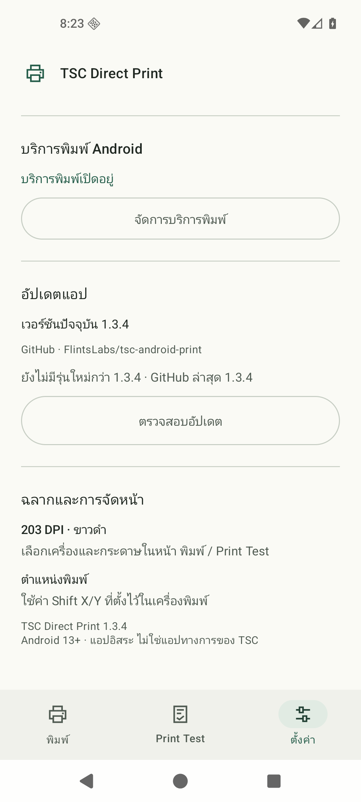

# TSC Direct Print — English guide

[ภาษาไทย / screenshots](../README.md) · [Download APK](https://github.com/FlintsLabs/tsc-android-print/releases/latest) · [Build](building.md) · [Verification](verification.md)

An independent Android Print Service for **TSC MH261T, 203 DPI**. It converts PDF pages to monochrome TSPL bitmaps and sends them directly over **configurable TCP endpoints (default 9100)**. A Mac, USB cable or print server is not needed. The UI is currently Thai, with light/dark themes and adaptive navigation.

**Published version: [1.3.4 (versionCode 9)](https://github.com/FlintsLabs/tsc-android-print/releases/tag/v1.3.4).** Settings now includes manual GitHub Release checks, APK download and verified native installation. See the [changelog](../CHANGELOG.md) and [verification](verification.md). A source push does not automatically publish an APK.

[Download APK 1.3.4](https://github.com/FlintsLabs/tsc-android-print/releases/download/v1.3.4/TSC-Direct-Print-1.3.4.apk) · [SHA256SUMS.txt](https://github.com/FlintsLabs/tsc-android-print/releases/download/v1.3.4/SHA256SUMS.txt)

  
  
  

Screenshots show the signed 1.3.4 Release APK on an Android 16 / API 36 emulator. Loopback IPs are demonstration endpoints; replace them with actual printer IPs. Android Print images show a loopback preview, with no physical print submitted. See the [full screenshot set](../README.md) and [capture details](images/README.md).

## Install and connect

1. Download the APK and checksum from the same Release. On macOS, verify with `shasum -a 256 -c SHA256SUMS.txt`, then install on **Android 13+**. Allow installation from the app opening the file when Android requests it.
2. Open **ตั้งค่า → แตะชื่อเครื่องพิมพ์** (Settings → tap the printer row), enter its name, IPv4, port and default paper, then press **บันทึกเครื่องพิมพ์** (Save printer). Replace the bundled default 192.168.70.37 with your own printer address.
3. Open that printer's row again and press **ตรวจการเชื่อมต่อ** (Check connection). This checks the saved viewed endpoint without printing.
4. Return to **รายการเครื่องพิมพ์** (Printer list), press **จัดการบริการพิมพ์** (Manage print services) and turn **TSC Direct Print** on in Android Settings.
5. Grant local-network access if Android requests it. The phone must reach the printer; guest Wi-Fi/client isolation may block it.

Select the installed TSC service instead of adding an IP through Android's Default Print Service, which uses different protocols/discovery.

For CipherLab RS38, see the [installation guide](rs38.md). The app requires Android 13+ and an available Android print framework; one RS38 running Android 13 has physically printed with 1.2.1, but firmware variants still need verification.

## Print

Use the normal **Print** action in a browser/PDF viewer that supports Android printing. Select the saved printer name and IP, review paper size, orientation, pages and copies, then confirm. To select a PDF directly, open **พิมพ์ → เลือก PDF เพื่อพิมพ์** (Print → Choose PDF). The same system dialog appears.

This service cannot add printing to a browser or WebView that does not provide it.

## Multiple printers

Save up to 20 printer profiles through **ตั้งค่า → เพิ่มเครื่องพิมพ์** (Settings → Add printer). Each profile has a name, IPv4, port and independent paper default; all use the 203 DPI TSPL pipeline. Since 1.3.3, Settings shows a navigable list with endpoints and paper defaults. Tap a row to open that printer's settings. Opening, editing or adding a profile keeps the current print selection. Print and Print Test share a compact selector with a down-chevron and printer count. Selection is an app preference, not an online status. Saved custom stock sizes are available across profiles. Duplicate IP+port pairs are rejected. Edit/delete through Settings; at least one profile must remain.

**Android's Print dialog controls the actual destination.** It can remember a previous printer: select/review the intended name and IP again before confirmation. App selection restores defaults; it cannot programmatically override Android's printer choice. Probe and diagnostic actions in printer details use the saved viewed profile.

Jobs retain an immutable endpoint when accepted by the service. Changing the app selection or editing profiles afterwards cannot redirect those jobs. Deleted/unknown IDs fail instead of falling back to another printer. Each endpoint is serial; different endpoints run on up to 3 workers, with 32 accepted jobs total. No broadcast printing or automatic retry is added. Existing 1.2.x settings migrate automatically, keeping the original printer ID.

## Paper sizes

Set each printer's default through **ตั้งค่า → แตะชื่อเครื่องพิมพ์ → กระดาษเริ่มต้นของเครื่องนี้ → บันทึกเครื่องพิมพ์**. App paper changes are remembered for the selected profile; changes inside Android Print apply to that job. Android can remember previous job options, so review the final media before confirming.

Presets: **102 × 76 mm** and **148 × 210 mm (A5)**. Add custom sizes through **ตั้งค่า → แตะชื่อเครื่องพิมพ์ → เพิ่มขนาดกระดาษเอง** (Settings → printer details → Add custom size), then **บันทึกและใช้ขนาดนี้** (Save and use) and **บันทึกเครื่องพิมพ์** (Save printer) to apply it to that profile. The details page also provides a targeted connection check and test-print action; save draft changes first. Android Print still requires destination review and confirmation.

Width runs across the print head; height follows feed. App bounds: **20–168 mm wide**, **20–500 mm high**, one decimal place, up to **20 saved custom sizes**. These are app limits, not the printer's maximum label length.

Available sizes are shared by Print, Print Test and system Paper size; the default selection is saved separately for each printer. The final job's media selection is authoritative. For A5, keep physical 148 × 210 mm and change portrait/landscape separately. Match loaded stock and calibrate the printer sensor when changing rolls.

## Print Test

Open Print Test, choose a printer and paper, press **พิมพ์ฉลากทดสอบ**, and confirm the printer/media and **one copy** in Android's dialog. The diagnostic includes four borders around 2 mm from the edges, an 80 mm ruler (shorter/labeled on narrow stock), a QR containing TSC-TEST-001, and white text on black fill.

Opening preview does not print. The README label image is rendered output, not a photograph of physical stock.

## Limits and recovery

- PDF: 100 MiB / 100 pages; up to 100 copies and 1,000 total labels per job.
- Fit, center, rotate; threshold-128 monochrome without photo dithering. Copies are collated; pages are staged before connecting.
- Partial sends are never retried automatically. Canceling cannot retract data already accepted by the printer; inspect output before resending.
- Completed means TCP transmission, not physical confirmation. Paper/ribbon/cover status polling is not implemented.
- No telemetry/cloud upload. Temporary files stay in private cache and are cleaned after use. TCP 9100 is not encrypted.
- Shift, Reference, gap sensor, ribbon, speed and density are not modified.
- Other TSPL models and 300/600 DPI printers have not been tested.

On Xiaomi/Redmi/HyperOS, printing that works only while USB is attached may involve app freezing. Check **App info → Power → No restrictions**. The observed Redmi case also required restarting Android Print Spooler, closing the old dialog and creating a new job. A fresh web job was then user-confirmed to print without USB. This is observed recovery, not an OEM-wide guarantee; see [troubleshooting](troubleshooting.md).

Missing backgrounds in the source PDF must be corrected in the originating website's print CSS/PDF generation. The service cannot recover omitted content.

## Update in the app

After installing 1.3.4 or newer once, open **ตั้งค่า → อัปเดตแอป → ตรวจสอบอัปเดต** (Settings → App updates → Check for updates). Download the newer stable release. The app verifies SHA-256, package, version and signing certificate, then asks you to allow installations from TSC Direct Print. Return to the app, tap Install update, and confirm Android's installer. Wait for print jobs to finish first. Updating with the same signing key retains printer profiles and paper settings; do not uninstall the existing app.

Checking/downloading needs Internet access to GitHub. Printing continues directly over the LAN. There are no automatic background checks or silent installs. See [update details and recovery](updating.md).

## Development / license

See [building](building.md), [architecture](architecture.md), [verification](verification.md) and [changelog](../CHANGELOG.md). Project code uses [MIT](../LICENSE); dependencies retain their own licenses, listed in [NOTICE](../NOTICE). No vendor driver binaries, firmware or proprietary SDK are included. This project is not affiliated with or endorsed by TSC.
