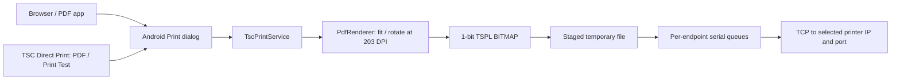

# Architecture

The service advertises every saved profile using its stable PrinterId, name, IPv4/port, fixed 203 DPI resolution and saved paper sizes. Each profile selects its own default stock. Discovery independently probes endpoints without sending print commands, removes deleted profiles and polls while discovery/state tracking remains active. Up to three probes run concurrently; offline endpoints do not block listing others.

PrinterSettings stores a validated catalog as one SharedPreferences JSON value. First load migrates legacy host and paper with the original mh261t ID. New profiles use UUIDs. IDs and normalized endpoints must be unique; malformed stored catalogs fail closed without overwriting them. An immutable profile snapshot is resolved from the confirmed job's exact PrinterId, never from the app's current default. Removed/unknown IDs fail before transport. The app's Print / Print Test selector restores defaults; Android Print makes the final destination choice through its own dialog. Settings uses an independent details route: opening, saving or adding a profile preserves app selection. Probe and diagnostic actions capture the saved viewed profile, and draft changes must be saved before either action.

PrinterJobQueue bounds total accepted jobs to 32, serializes each physical IP:port and runs different endpoints on up to 3 workers. Already accepted jobs retain their endpoint even if a profile is edited/deleted or the app switches defaults.

On confirmation it copies the framework PDF, resolves physical dimensions from the job's media ID, renders selected pages, and stages TSPL before connecting. Android may prune page ranges before delivery; page selection handles both full and pruned documents. Pages are fitted, centered and rotated into the physical stock dimensions.

Pixels become 1-bit rows at threshold 128. Each label emits SIZE, DIRECTION 1,0, CLS, BITMAP in mode 1, and PRINT 1,1. Padding stays white. Copies repeat the staged document in collated order. The transport has connect/write deadlines, closes resources on cancellation and never automatically retries a partial send.

| Source | Responsibility |
| --- | --- |
| [TscPrintService.java](../app/src/main/java/com/revolic/tscprint/TscPrintService.java) | Discovery, Android job lifecycle, asynchronous dispatch |
| [PrinterSettings.java](../app/src/main/java/com/revolic/tscprint/PrinterSettings.java) / [PrinterCatalog.java](../core/src/main/java/com/revolic/tscprint/core/PrinterCatalog.java) | Migration, validation and saved printer profiles |
| [PrinterJobQueue.java](../core/src/main/java/com/revolic/tscprint/core/PrinterJobQueue.java) | Bounded per-endpoint ordering and cross-printer concurrency |
| [PdfSpooler.java](../app/src/main/java/com/revolic/tscprint/PdfSpooler.java) | Bounded copy, PDF rasterization, staging |
| [MainActivity.kt](../app/src/main/java/com/revolic/tscprint/MainActivity.kt) / [PrintApp.kt](../app/src/main/java/com/revolic/tscprint/PrintApp.kt) | Compose UI and Print entry points |
| [PaperSettings.java](../app/src/main/java/com/revolic/tscprint/PaperSettings.java) / [PaperSize.java](../core/src/main/java/com/revolic/tscprint/core/PaperSize.java) | Saved sizes, media IDs, validation and dimensions |
| [TestLabel.java](../app/src/main/java/com/revolic/tscprint/TestLabel.java) | Shared preview/PDF diagnostic drawing |
| [TsplEncoder.java](../core/src/main/java/com/revolic/tscprint/core/TsplEncoder.java) | Bitmap packing and TSPL framing |
| [JobTransport.java](../core/src/main/java/com/revolic/tscprint/core/JobTransport.java) | TCP send, cancellation and deadlines |

A completed send is not a hardware acknowledgment. Printer status polling and calibration are outside this implementation. Shift, Reference, sensors, ribbon, speed and density remain printer settings. Temporary jobs are private, cleaned on completion and swept at process startup.

API 37 declares/requests local-network access; runtime acceptance currently covers API 36. No vendor driver, firmware or proprietary SDK is loaded. See [verification.md](verification.md).

## Manual app updates

`UpdateViewModel` owns a separate worker and explicit UI states. `GitHubReleaseClient` reads the anonymous latest Release API for `FlintsLabs/tsc-android-print`, accepts stable numeric tags and exact APK/checksum asset names, and follows bounded HTTPS redirects to GitHub download hosts. It enforces metadata/manifest/APK size limits and verifies SHA-256 while downloading. No printer data or documents are sent to GitHub.

`UpdateInstaller` checks the downloaded file again, package name, version name/code, Android compatibility and current signer identity. Private `files/updates` storage and an atomic pending ticket permit local verification after process restart; the non-exported FileProvider grants the native installer temporary read access only to that directory. Android's installer performs installation/signature enforcement and requires user confirmation. The app does not install silently, automatically retry installation, modify printer preferences or check in the background. Installer launch failures and canceled installation leave a verified file available for retry. The user should finish print jobs before updating.
