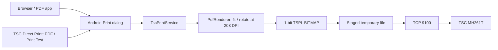

# Architecture

The service advertises one printer, the configured IPv4 address, a 203 DPI resolution and saved paper sizes. Discovery probes the TCP endpoint without sending print commands.

On confirmation it copies the framework PDF, resolves physical dimensions from the job's media ID, renders selected pages, and stages TSPL before connecting. Android may prune page ranges before delivery; page selection handles both full and pruned documents. Pages are fitted, centered and rotated into the physical stock dimensions.

Pixels become 1-bit rows at threshold 128. Each label emits SIZE, DIRECTION 1,0, CLS, BITMAP in mode 1, and PRINT 1,1. Padding stays white. Copies repeat the staged document in collated order. The transport has connect/write deadlines, closes resources on cancellation and never automatically retries a partial send.

| Source | Responsibility |
| --- | --- |
| [TscPrintService.java](../app/src/main/java/com/revolic/tscprint/TscPrintService.java) | Discovery, Android job lifecycle, asynchronous dispatch |
| [PdfSpooler.java](../app/src/main/java/com/revolic/tscprint/PdfSpooler.java) | Bounded copy, PDF rasterization, staging |
| [MainActivity.kt](../app/src/main/java/com/revolic/tscprint/MainActivity.kt) / [PrintApp.kt](../app/src/main/java/com/revolic/tscprint/PrintApp.kt) | Compose UI and Print entry points |
| [PaperSettings.java](../app/src/main/java/com/revolic/tscprint/PaperSettings.java) / [PaperSize.java](../core/src/main/java/com/revolic/tscprint/core/PaperSize.java) | Saved sizes, media IDs, validation and dimensions |
| [TestLabel.java](../app/src/main/java/com/revolic/tscprint/TestLabel.java) | Shared preview/PDF diagnostic drawing |
| [TsplEncoder.java](../core/src/main/java/com/revolic/tscprint/core/TsplEncoder.java) | Bitmap packing and TSPL framing |
| [JobTransport.java](../core/src/main/java/com/revolic/tscprint/core/JobTransport.java) | TCP send, cancellation and deadlines |

A completed send is not a hardware acknowledgment. Printer status polling and calibration are outside this implementation. Shift, Reference, sensors, ribbon, speed and density remain printer settings. Temporary jobs are private, cleaned on completion and swept at process startup.

API 37 declares/requests local-network access; runtime acceptance currently covers API 36. No vendor driver, firmware or proprietary SDK is loaded. See [verification.md](verification.md).
